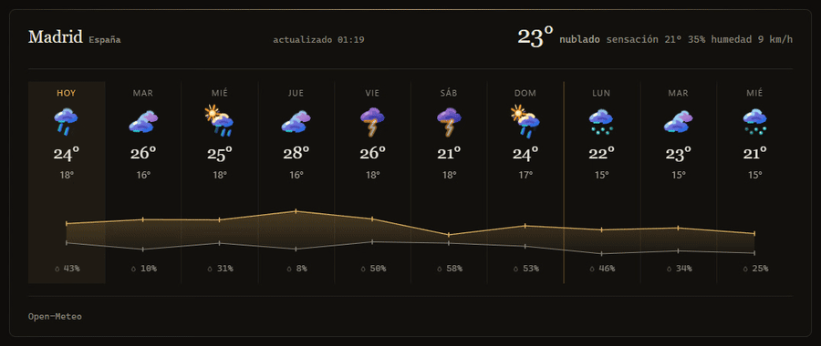
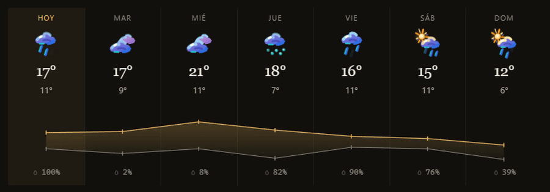
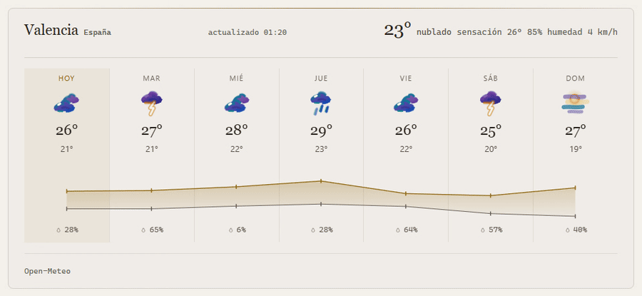
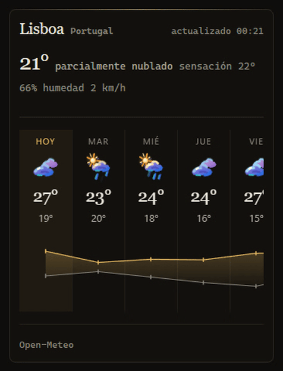

# buentiempo

Previsión meteorológica embebible en cualquier web con una sola etiqueta. Web component nativo `<buen-tiempo>`: sin dependencias, sin compilación, sin servidor y sin clave de API (datos de [Open-Meteo](https://open-meteo.com)).



| Iconos animados | Tema claro y buscador | Móvil |
|---|---|---|
|  |  |  |

## Uso

```html
<script type="module" src="https://cdn.jsdelivr.net/gh/jaimealekos/buentiempo@v1.0.0/buentiempo.js"></script>

<buen-tiempo place="Valencia" country="España"></buen-tiempo>
```

Autoalojado: copia `buentiempo.js` y `src/` (y `fonts/` si quieres las tipografías) a tu web y cambia la URL.

El widget ocupa el ancho de su contenedor y se adapta con container queries: por debajo de 30rem la fila de días se desplaza en horizontal.

## Atributos

Todos opcionales. Cada uno tiene su propiedad JS equivalente (`el.days = 10`).

| Atributo | Propiedad | Valores | Por defecto |
|---|---|---|---|
| `place` | `place` | nombre de ciudad (se geocodifica) | — |
| `country` | `country` | país, para desambiguar | — |
| `latitude`, `longitude` | `lat`, `lon` | coordenadas; evitan la geocodificación | — |
| `days` | `days` | 1–16 | `7` |
| `lang` | `lang` | `es`, `en` o uno registrado | `es` |
| `units` | `units` | `metric`, `imperial` | `metric` |
| `timezone` | `timezone` | zona IANA o `auto` | `auto` |
| `theme` | `theme` | `dark`, `light`, `auto` | `auto` |
| `hourly-step` | `hourlyStep` | horas entre puntos de la línea horaria | `2` |
| `show-current` | `showCurrent` | condiciones actuales en la cabecera | `true` |
| `show-hourly` | `showHourly` | línea por horas al pasar sobre un día | `true` |
| `editable` | `editable` | el título es un buscador de ciudad | `true` |
| `remember` | `remember` | recuerda en `localStorage` la ciudad elegida | `false` |
| `refresh` | `refresh` | minutos entre recargas; `0` desactiva | `15` |
| `week-start` | `weekStart` | `monday`, `sunday` | `monday` |
| `animate` | `animate` | iconos animados (respeta `prefers-reduced-motion`) | `true` |

Booleanos: presencia, `true` o `1` activan; `false` o `0` desactivan. Valores fuera de rango vuelven al defecto (`days` se ajusta a 1–16).

Orden para decidir el lugar: ciudad recordada (con `remember`), coordenadas, `place`.

```html
<buen-tiempo latitude="40.42" longitude="-3.70" place="Madrid"
             days="10" lang="en" units="imperial" theme="light"
             editable="false" refresh="30"></buen-tiempo>
```

## Eventos

`CustomEvent` con `bubbles` y `composed`.

| Evento | `detail` |
|---|---|
| `bt-load` | previsión normalizada: `{ ts, zona, lugar, pais, actual, dias, horas }` |
| `bt-error` | `{ message }` |
| `bt-place-change` | `{ place, country, latitude, longitude, timezone }` |

```js
document.querySelector('buen-tiempo')
  .addEventListener('bt-place-change', (e) => console.log(e.detail.place));
```

## Estilo

Variables CSS sobre el elemento. Las principales:

```css
buen-tiempo {
  --bt-bg-1: #1b1a17;          /* tarjeta */
  --bt-text: #efe9dd;          /* texto y máximas */
  --bt-text-3: #9a9384;        /* etiquetas, mínimas, lluvia */
  --bt-accent: #e2b55c;        /* oro: hoy, máximas, foco */
  --bt-border: #3a3731;
  --bt-radius-m: 8px;
  --bt-pad: 1rem 1.5rem;
  --bt-icon: 44px;             /* icono de cada día */
  --bt-day-min: 4.25rem;       /* ancho mínimo de día antes de desplazar */
}
```

Lista completa (color, tipografía, espaciado, duraciones de cada animación) en [docs/DISENO.md](docs/DISENO.md#3-variables-públicas---bt-). Para retoques finos, `::part()`: `widget`, `lugar`, `pais`, `meta`, `ahora`, `campo`, `sugerencias`, `sugerencia`, `dias`, `dia`, `dia-nombre`, `dia-icono`, `dia-max`, `dia-min`, `dia-lluvia`, `banda`, `horas`, `hora`, `hora-temp`, `hora-lluvia`, `vacio`, `esqueleto`, `pie`.

```css
buen-tiempo::part(dia-max) { color: tomato; }
```

## Tipografías

Por defecto usa la pila del sistema y no pide nada a la red. Para el aspecto de las capturas (Fraunces, Geist y Geist Mono, autoalojadas, OFL):

```html
<link rel="stylesheet" href="https://cdn.jsdelivr.net/gh/jaimealekos/buentiempo@v1.0.0/fonts/buentiempo-fonts.css">
```

O tus propias fuentes con `--bt-font-display`, `--bt-font-text` y `--bt-font-mono`.

## Idiomas

Castellano e inglés incluidos. Otro idioma: registra un diccionario (las claves que falten salen del castellano; la lista de claves está en [src/i18n.js](src/i18n.js)).

```js
import { registrarIdioma } from 'https://cdn.jsdelivr.net/gh/jaimealekos/buentiempo@v1.0.0/src/i18n.js';
registrarIdioma('ca', { hoy: 'avui', /* … */ });
```

## Desarrollo

```bash
npm test                          # node --test, sin red
python -m http.server 8765        # y abre http://localhost:8765/demo/
```

Arquitectura en [docs/ARQUITECTURA.md](docs/ARQUITECTURA.md); contratos por módulo en `docs/modulos/`.

## Licencia

MIT. Tipografías bajo SIL Open Font License 1.1 (`fonts/OFL.txt`). Datos meteorológicos de Open-Meteo (CC BY 4.0).
